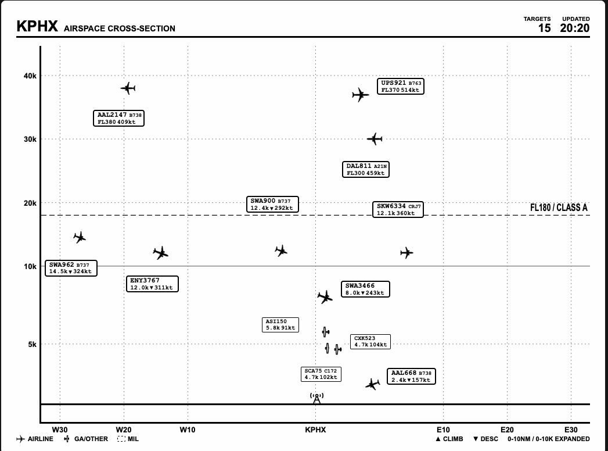
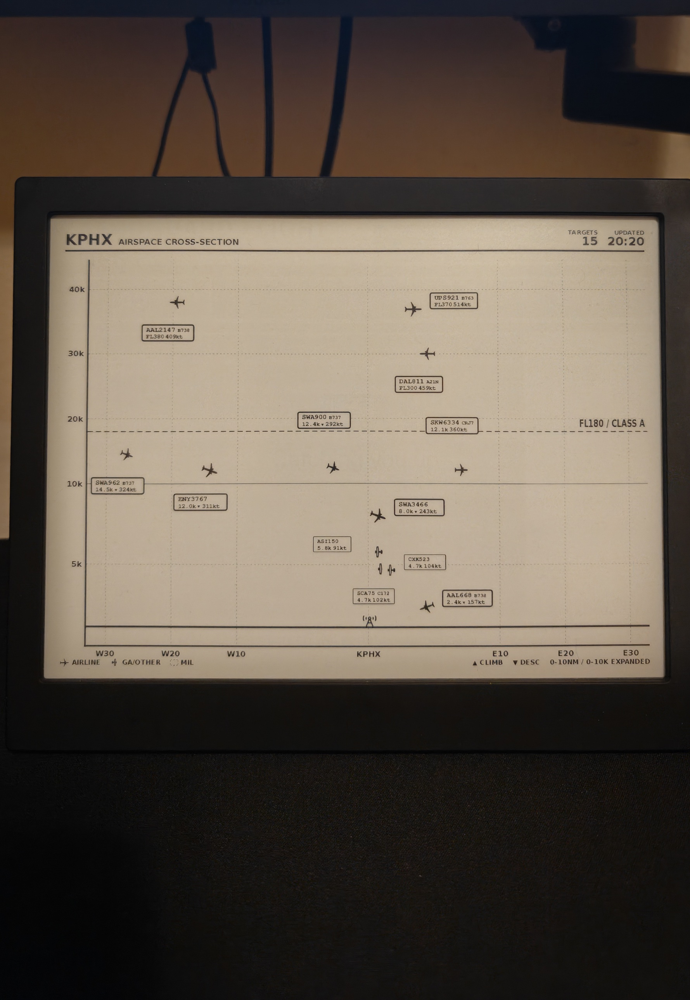

# KPHX Airspace Cross-Section — a TRMNL plugin

A live **vertical slice of the sky** over your airport, drawn on an e-ink screen. Altitude runs up the side, distance east and west of the airport runs along the bottom, and every aircraft in range is a real silhouette (A320, B738, Cessna, helicopter…) with a data tag that never overlaps another one.

Built for [TRMNL](https://usetrmnl.com), powered by free community ADS-B data, and served by a small Cloudflare Worker that does all the heavy lifting so the Liquid template stays a simple renderer.

> 📖 **More from the author:** I'm a cadet pilot training at Phoenix Deer Valley and I write about building for TRMNL on TurbulenceGains: [TRMNL review](https://turbulencegains.com/trmnl-review-2026/) · [TRMNL Flight Radar guide](https://turbulencegains.com/trmnl-flight-radar-guide/) · [all my projects](https://turbulencegains.com/about/#projects).


| Plugin preview (TRMNL X, 16 grays) | On the device |
| :---: | :---: |
|  |  |

> **Not for navigation.** This is a hobby / situational-awareness display built on community-fed, unverified ADS-B data. It can be delayed, incomplete, or wrong. Never use it for flight planning, separation, or any operational decision.

---

## Features

- **Real aircraft silhouettes** chosen from the ICAO type code (about 30 shapes, from A380 and B737 variants to helicopters, gliders, and fighters).
- **Airliners vs. everything else** at a glance: solid black silhouette and a heavy border for airline traffic, outlined silhouette for GA/other, dashed tag border for military.
- **Expanded low-altitude band.** 0–10,000 ft gets about half the chart height and 0–10 NM gets half the width, so the busy airport traffic doesn't pile up in one corner.
- **Collision-free labels.** The worker places each data tag by testing 48 candidate positions around the aircraft and picking the first free one, with a leader line when a tag has to sit further away.
- **Airport at the center** (W30 … KPHX … E30) with planes facing east or west by their actual heading, or a radial layout with the airport on the left.
- **Climb / descent arrows** (±500 fpm), flight levels above 18,000 ft, and a **FL180 / Class A** line.
- **Route codes** (e.g. `DFW-PHX`) on airliner tags when a route is known.
- **Hatched ground strip** at field elevation, with a tower icon at the airport.
- **Resilient data path:** three ADS-B sources with automatic fallback, a short edge cache, and the last good snapshot served if every source fails.

## How it works

```
 airplanes.live ─┐
 adsb.lol ───────┼─►  Cloudflare Worker  ──►  KV cache  ──►  JSON  ──►  TRMNL (Polling)  ──►  Liquid  ──►  e-ink
 adsb.fi ────────┘     (cron every ~2 min)                    "xs" layout              renders the SVG/HTML
                       - picks which aircraft to show
                       - projects them onto the chart
                       - places non-overlapping labels
```

1. A **cron trigger** runs the worker every couple of minutes. It queries the first ADS-B source that answers, filters and ranks aircraft, looks up routes for airliners, computes the whole chart layout, and stores the JSON in **Workers KV**.
2. **TRMNL polls** the worker URL, which returns the cached JSON immediately.
3. The **Liquid template** (`full.liquid`) only draws what the JSON describes: gridlines, ticks, icons, tags, and legend.

## What's in this repo

| File | Purpose |
| --- | --- |
| `worker.js` | Cloudflare Worker: data fetch, aircraft selection, projection, label layout, JSON payload |
| `full.liquid` | TRMNL private-plugin markup (**Full** layout) |
| `wrangler.toml` | Only needed for the CLI route (Option B); see the example above |
| `docs/` | Screenshots used by this README |

---

## Setup

### Requirements

- A TRMNL device and account (developed and tested on a **TRMNL X**)
- A free [Cloudflare](https://cloudflare.com) account
- Optional: [Node.js](https://nodejs.org) 18+ if you prefer deploying with the `wrangler` CLI (not needed for the copy-and-paste route)

### 1. Deploy the Worker

`worker.js` is a single self-contained file with no dependencies, so you can either **paste it straight into the Cloudflare dashboard** or deploy it with the CLI. Pick whichever you prefer.

#### Option A: copy and paste into the Cloudflare dashboard (no tools needed)

1. Open `worker.js` on GitHub and copy the whole file (use the **Raw** or **Copy raw file** button).
2. In the [Cloudflare dashboard](https://dash.cloudflare.com), go to **Workers & Pages → Create → Create Worker**. Name it (for example `kphx-cross-section`) and click **Deploy**.
3. Click **Edit code**, delete the placeholder code, paste `worker.js`, and click **Deploy**.
4. **Create a KV namespace** (under **Storage & Databases → KV**), for example `FLIGHT_KV`.
5. In your Worker, open **Settings → Bindings → Add → KV namespace**. Set the **variable name to exactly `FLIGHT_KV`** and pick the namespace you just created.
6. In **Settings → Triggers → Cron Triggers**, add `*/2 * * * *` (every 2 minutes, see the note on KV limits below).
7. Optional: add variables under **Settings → Variables and Secrets** (see [Configuration](#configuration)). Everything has a default.

Your worker URL is shown on the Worker's overview page (`https://<name>.<your-subdomain>.workers.dev`). Open it in a browser. You should see JSON with a `merge_variables` object containing `flights` and `xs`.

> Cloudflare occasionally renames dashboard menus. If a label differs, look for the same idea: create a Worker, bind a KV namespace as `FLIGHT_KV`, and add a cron trigger.

#### Option B: Wrangler CLI

```bash
npm install -g wrangler        # or use npx wrangler ...
wrangler login

# create the KV namespace the worker caches into
npx wrangler kv namespace create FLIGHT_KV
```

Copy the namespace `id` from the output into a `wrangler.toml`:

```toml
name = "kphx-cross-section"
main = "worker.js"
compatibility_date = "2026-10-01"

[[kv_namespaces]]
binding = "FLIGHT_KV"            # must be exactly this name
id = "<your-kv-namespace-id>"

[triggers]
crons = ["*/2 * * * *"]          # every 2 minutes (see the note on KV limits below)

# Optional: everything has a sensible default, see "Configuration"
# [vars]
# LATITUDE = "33.4343"
# LONGITUDE = "-112.0116"
# RADIUS_NM = "30"
# AIRPORT_LABEL = "KPHX"
```

Then deploy with `npx wrangler deploy`. Wrangler prints your worker URL.

> **Free-plan note:** Workers KV's free plan allows **1,000 writes per day** (per Cloudflare's documented limits), and each cron run writes once. Every 2 minutes is about 720 writes/day, which fits. Every minute would be about 1,440 and would exceed it. If you need faster updates, use the paid plan.

> **First request:** if the cache is empty (before the first cron run), the worker fetches fresh data on demand, so the first call can take a few seconds because of the route lookups.

### 2. Create the TRMNL plugin

1. In TRMNL, go to **Plugins → Private Plugin → New**.
2. Set **Strategy** to **Polling**.
3. Set **Polling URL** to your worker URL, **Polling Verb** to `GET`.
4. Open the **Markup Editor**, select the **Full** tab, and paste the contents of `full.liquid`.
5. Save, check the live preview, then add the plugin to a playlist.

**Use Polling, not Webhook.** The payload is about 15–16 KB for 15 aircraft, well above TRMNL's documented webhook request size (5 KB on TRMNL+). Polling has no such limit.

The template is **Full layout only**. It uses absolute positioning against the whole screen, so don't drop it into a half or quadrant slot.

### 3. Check it

- The header shows your airport, the target count, and the update time.
- If the screen says **NO TARGETS IN RANGE**, open the worker URL directly. A healthy response has aircraft in `flights`; if all data sources failed and nothing is cached, the JSON contains an `error_message`.

---

## Configuration

Every setting is optional. Set them as Worker variables (`[vars]` in `wrangler.toml`, or **Workers → Settings → Variables** in the dashboard). Values are strings; defaults live in `DEFAULT_CONFIG` at the top of `worker.js`.

### Location and range

| Variable | Default | What it does |
| --- | --- | --- |
| `LATITUDE` | `33.4343` | Center of the chart (the airport) |
| `LONGITUDE` | `-112.0116` | Center of the chart (the airport) |
| `RADIUS_NM` | `30` | Search radius and half-width of the chart, in nautical miles |
| `AIRPORT_LABEL` | `KPHX` | Text shown in the header and at the center of the X axis |
| `OWNSHIP_ALT_FT` | `1135` | Field elevation in feet MSL. Sets where the ground strip sits |

### Which aircraft are drawn

| Variable | Default | What it does |
| --- | --- | --- |
| `LOW_SLOTS` | `5` | Nearest aircraft **below** `LOW_FT` (arrivals, departures, GA) |
| `LOW_FT` | `12000` | Altitude that separates "low" from "high" |
| `ALT_SLOTS` | `7` | Highest remaining aircraft (the cruise-level traffic) |
| `NEAR_SLOTS` | `3` | Extra nearby aircraft kept in the payload for the radar companion only (not drawn here) |

With the defaults the chart plots up to **12** aircraft: the 5 nearest low ones plus the 7 highest of the rest. Aircraft on the ground (no numeric altitude in the feed) are not shown.

### Layout

| Variable | Default | What it does |
| --- | --- | --- |
| `XS_MODE` | `ew` | `ew`: airport in the center, west on the left and east on the right. `radial`: airport on the left, distance increases to the right |
| `XS_W` / `XS_H` | `700` / `330` | Size of the chart box in the layout engine's pixel units. It is used only for label collision math. If tags touch on your screen, make these slightly smaller; if there's a lot of unused space, make them larger |

### Cache

| Variable | Default | What it does |
| --- | --- | --- |
| `ENABLE_KV` | `true` | Set to `"false"` to skip KV (the worker then fetches on every request, which is slower and hits the ADS-B APIs harder) |

The KV key name (`flight_cache_v3`) is a constant in `worker.js`. If you change the payload shape, bump it so you don't serve an old cached shape to a new template.

### Radar companion (optional)

The same payload also carries fields for a TCAS-style radar template (`tcas_x`, `tcas_y`, `heading`, `label_dx`, …). This plugin doesn't use them, so `PROXIMATE_NM` (`6`), `PROXIMATE_FT` (`1200`), and `SCOPE_PX` (`440`) can be left alone unless you run that template too.

### Using it at another airport

1. Set `LATITUDE`, `LONGITUDE`, `AIRPORT_LABEL`, and `OWNSHIP_ALT_FT` (field elevation).
2. Change the timezone in `worker.js` (the header time uses `timeZone: "America/Phoenix"`).
3. The **FL180 / Class A** line is a US convention. Edit or remove it in `layoutCrossSection` (`class_a_y`) if your airspace differs.
4. Check `AIRLINE_MAP` and the `CARGO` set for the carriers you care about. Callsigns that aren't in the map are treated as "GA/other".

---

## Reading the screen

| Element | Meaning |
| --- | --- |
| **Solid silhouette, heavy tag border** | Airline traffic (callsign prefix found in `AIRLINE_MAP`) |
| **Outlined silhouette, thin tag border** | GA / other |
| **Dashed tag border** | Military (database flag from the ADS-B feed) |
| **Silhouette direction and tilt** | Facing east or west by heading in `ew` mode, nose up or down when climbing or descending |
| **Tag line 1** | Callsign and ICAO type |
| **Tag line 2** | Altitude (`FL350` at or above 18,000 ft, otherwise `12.4k`), ▲/▼ for ±500 fpm, and groundspeed in knots |
| **Tag line 3** | Route (`DFW-PHX`), airliners only, when a route is known |
| **Thin line from a tag** | Leader line, only drawn when the tag had to sit away from its aircraft |
| **Y axis** | Altitude, with 0–10k ft expanded; the solid line is 10k |
| **X axis** | Nautical miles west/east of the airport, with 0–10 NM expanded |
| **Dashed line** | FL180 / Class A (shown when the highest aircraft is above 10,000 ft) |
| **Hatched strip and tower** | Ground at field elevation, and the airport |

The **TARGETS** number is the count of aircraft in the payload, which includes the `NEAR_SLOTS` extras that aren't drawn. With the defaults, you'll see 15 targets but 12 silhouettes.

---

## Data sources and etiquette

| Source | Used for |
| --- | --- |
| [airplanes.live](https://airplanes.live) | Primary positions feed |
| [adsb.lol](https://adsb.lol) | Fallback positions feed, and the route lookup |
| [adsb.fi](https://adsb.fi) | Second fallback positions feed |

These are volunteer-run networks. Please be a good citizen:

- Keep the refresh interval modest. The worker already uses a short edge cache and a single KV snapshot, so adding more TRMNL devices doesn't add upstream requests.
- airplanes.live describes its API as **non-commercial, rate-limited (about 1 request/second), with no uptime guarantee**. Read the current terms before building anything on top of it.
- The worker sends browser-style headers because some providers' firewalls reject default Worker requests. If a provider asks for a specific User-Agent or an API key, update `BROWSER_HEADERS` in `worker.js`.
- If you can, [feed one of these networks](https://airplanes.live) yourself. They only exist because people do.

## Known limitations

- **Routes can be wrong.** Route data comes from a community callsign-to-route database. It can be stale, and a round-trip callsign can show the same origin and destination.
- **Position is a projection.** In `ew` mode the horizontal position is the signed east-west offset, so a plane north of the airport appears near the center regardless of how far north it is. In `radial` mode it is the straight-line distance.
- **Label widths are estimated** from character counts, so an unusually wide callsign or type code can run a few pixels over its box.
- **The worker removes IndiGo (`IGO`) flights.** Delete the `.filter(f => !(f.airline === "IndiGo" ...))` line in `worker.js` if you want them back.
- **Only the Full layout** is supported.

## Troubleshooting

| Symptom | Likely cause and fix |
| --- | --- |
| Blank or old screen | TRMNL only refreshes when the device wakes. Check the plugin's refresh rate in your playlist, and use the live preview to confirm the markup is fine |
| `NO TARGETS IN RANGE` | Quiet sky, or the fetch failed. Open the worker URL and look at `flights` / `error_message`. Try a larger `RADIUS_NM` |
| Time is wrong | Change `timeZone` in `worker.js` |
| Tags overlap or run off the edge | Lower `XS_W` / `XS_H` a little, or reduce `LOW_SLOTS` / `ALT_SLOTS` |
| Stale data after editing the worker | The KV cache still holds the last payload until the next cron run, so wait one cycle or bump `KV_KEY` |
| `KV put() limit exceeded` in logs | Free-plan write limit. Slow the cron down (every 2 minutes or more) |
| Worker works in the browser but TRMNL shows nothing | Make sure **Strategy** is **Polling** and the URL is the worker root, with no trailing path |

---

## Credits

- **Aircraft silhouettes and the ICAO-type-to-silhouette mapping:** [tar1090](https://github.com/wiedehopf/tar1090) by **wiedehopf** and contributors. The plugin would look very different without this work.
- **ADS-B data:** [airplanes.live](https://airplanes.live), [adsb.lol](https://adsb.lol), and [adsb.fi](https://adsb.fi), and the thousands of volunteers who feed them.
- **Platform:** [TRMNL](https://usetrmnl.com) (e-ink device, Private Plugins, and the framework CSS) and [Cloudflare Workers + KV](https://workers.cloudflare.com).
- **Author:** Jay Kumar Bhatiya — [TurbulenceGains.com](https://turbulencegains.com), a publication at the intersection of aviation, wearable technology, and developer projects.
- Documentation developed with help from Claude (Anthropic).

<!-- TODO: add credit and license for the airport tower icon (ground_tower) once its source is confirmed. -->

## License

The aircraft silhouettes and the type-to-silhouette mapping come from tar1090, which is distributed under the GPL. Because this project includes that material, it should be distributed under a compatible GPL license too. Add a `LICENSE` file that matches the version in tar1090's own `LICENSE`, and keep the credit line in `full.liquid` intact.

---

*Blue skies, and happy spotting.*
